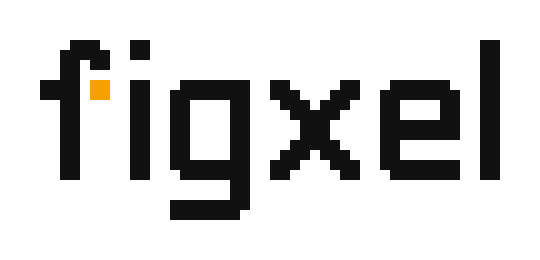
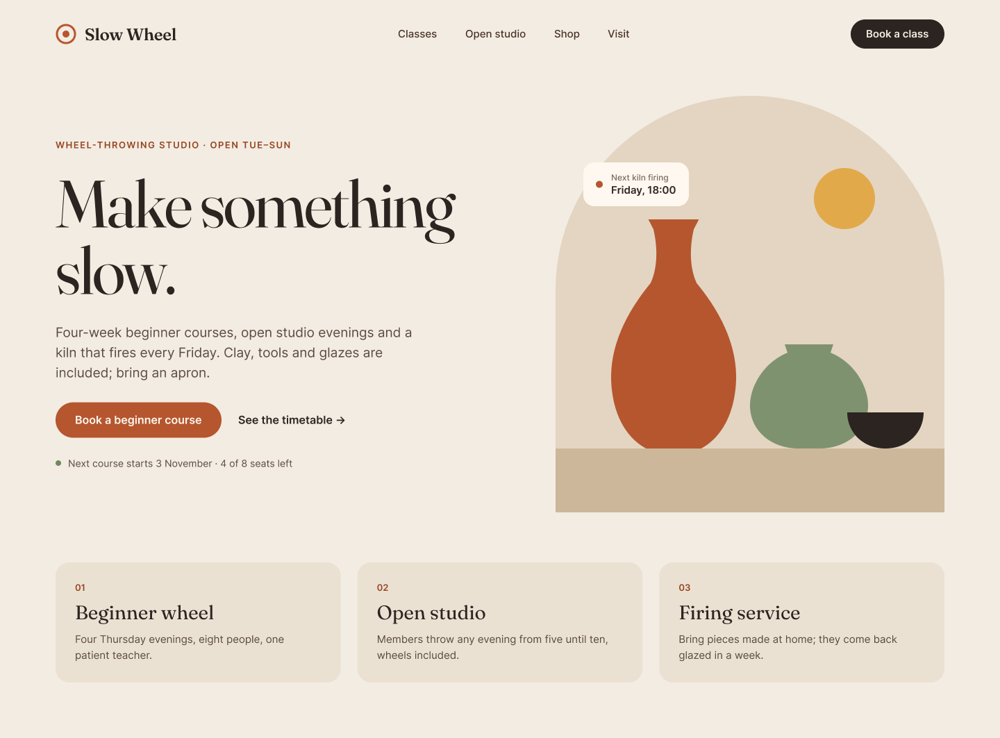
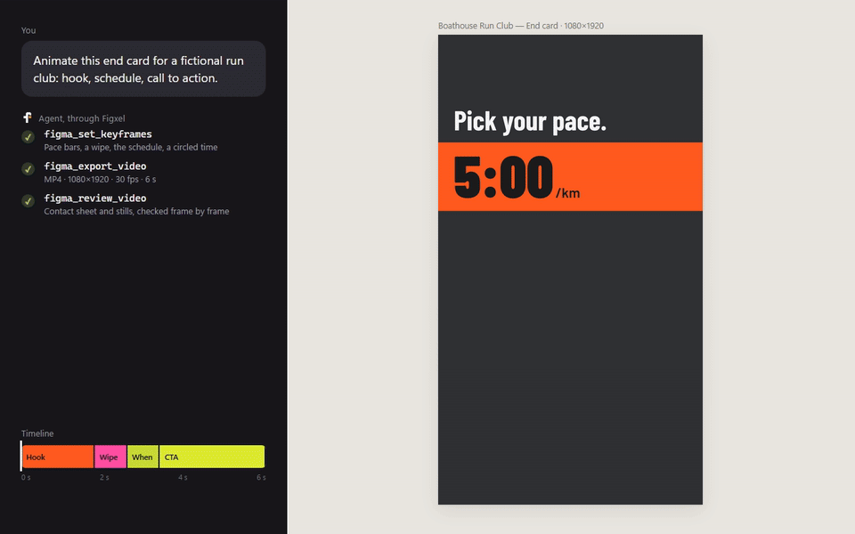

<p align="center">
  <picture>
    <source media="(prefers-color-scheme: dark)" srcset="assets/logo/lockup-reverse.png">
    
  </picture>
</p>

<p align="center"><strong>Let your AI agent read, design and animate in your Figma files.</strong></p>

<p align="center">
  <a href="https://www.npmjs.com/package/figxel-mcp"></a>
  <a href="LICENSE"></a>
  <a href="https://github.com/AvYour/figxel-mcp/actions/workflows/ci.yml"></a>
</p>

<p align="center">
  
  <br>
  <sub>One prompt in, real editable layers out: an agent builds a landing hero in Figma desktop.</sub>
</p>

**Figxel** is an MCP server with a small Figma desktop plugin. With it, an AI app such as Claude, ChatGPT, Cursor or VS Code can read, build and animate real designs in the file you have open, guided by skills that teach it to work like a designer. It runs on your computer, or through a hub on a server that your team runs or that you are invited to ([Figxel Cloud and hubs](#figxel-cloud-and-team-hubs)).

> Figxel is not affiliated with, endorsed or sponsored by Figma, Inc. Figma is a trademark of Figma, Inc.

Tested live on Windows; macOS has not been run live yet.

## Why Figxel

- **It works with the AI app you already use.** Claude, Cursor, VS Code, Codex, Gemini CLI or any other app that runs local MCP servers, whatever model it runs.
- **It reads and writes your real Figma file.** A plugin runs in Figma desktop, so the agent makes editable layers, components and variables in the file you have open.
- **It never silently overwrites your edits.** When you change something the agent read earlier, its next write to it is refused until it reads again `[C-397]`; each instruction can be taken back in one step, and only when that takes back nothing of yours.
- **The agent works like a designer, in the role the work needs.** UI/UX, graphic, illustration, brand, presentation, design system, board or motion: each role has its own workflow, with planning before the work and testing after it. The tools enforce it: new work starts with a brief, ends with a sign-off that runs the role's checks, and a final export waits for that sign-off. For motion, a plan comes before the first keyframe.
- **It is local by default and open source.** The server runs on your machine and listens only on `127.0.0.1`; a team can run its own hub instead. MIT licensed.

## What you can do

Ask in plain words; the agent picks the tools.

- **Read a design**: layers, design context for writing code, screenshots and exports (PNG, JPG, SVG, PDF), variables, styles and fonts.
- **Build and edit**: a whole section in one call (`figma_create_from_spec`) or frame by frame. Each call is one Ctrl+Z step in Figma.
- **Work with a design system**: components and variants, styles, variables with modes, and library assets.
- **Prototype and animate**: prototype flows, keyframes, storyboards and video export, checked with `figma_check_motion`.
- **Check its own work**: `figma_check_layout` finds overflowing text, clipped or overlapping content, low contrast and placeholder copy, and its audits measure target sizes, focus and error states, copy, the brief's grid and type scale, a mark at its smallest size, a deck's density and how much is bound to your variables, each with the fix.
- **Stress-test a design**: `figma_stress_test` makes copies with translated, longer and bigger content and many or no items, checks each, and says what broke, before real content arrives.
- **FigJam and Figma Slides**: reads work today; board and deck writes stay refused until a live run verifies them.
- **Follow a process**: fourteen skills, from design and motion to critique, reach every app through `figma_get_guide`, MCP prompts and `skill://` resources.

That is 140 tools by default: see the [tool catalog](docs/reference/tools.md).

## Requirements

- **Figma desktop** on macOS 12 or later, or Windows 10 or later (64-bit) or Windows on Arm `[C-273]`.
- **Node.js 22 or later.**
- **An AI app that runs local (stdio) MCP servers** ([setup per app](docs/clients.md)).
- **Optional: ffmpeg** on your PATH, so the agent can review its video renders frame by frame.

## Quickstart

1. **Quit Figma desktop completely, then run setup** in a terminal. On Windows, closing Figma's window is not enough: quit it from its icon in the notification area `[C-341]`.

   ```bash
   npx -y figxel-mcp@latest setup --register
   ```

   Setup creates a token, copies the plugin into `~/.figxel/plugin`, lists it in Figma's development plugins `[C-323]`, and prints the token and the entries for your AI app.

2. **Run the plugin.** Open Figma and a file, choose **Plugins → Development → Figxel**, paste the token and press **Save**. You paste the token once, and run the plugin once per Figma session ([why](#why-do-i-have-to-start-the-plugin-myself)).

3. **Add the server to your AI app.** In Claude Desktop, **Settings → Developer → Edit Config** opens `claude_desktop_config.json` `[C-277]`. Add Figxel under `mcpServers`:

   ```json
   {
     "mcpServers": {
       "figxel": { "command": "npx", "args": ["-y", "figxel-mcp@latest"] }
     }
   }
   ```

   On Windows, start it through `cmd`, because an app that starts `npx` without a shell fails there `[C-281]`:

   ```json
   {
     "mcpServers": {
       "figxel": { "command": "cmd", "args": ["/c", "npx", "-y", "figxel-mcp@latest"] }
     }
   }
   ```

   In Claude Code, this command works on every operating system `[C-279]` `[C-280]`:

   ```bash
   claude mcp add -s user figxel -- npx -y figxel-mcp@latest
   ```

   Other apps: [docs/clients.md](docs/clients.md).

4. **Try it.** Restart your AI app (quit Claude Desktop completely `[C-277]`) and ask it to *call figma_status*: it should list your open file. Then ask for real work, such as *"Design a landing hero for Slow Wheel, a fictional pottery studio."* [Using Figxel](docs/usage.md) shows how to brief the agent and review its work.

Setup's backup of Figma's settings, `--dry-run`, `--force`, `--unregister`, the manual import and the macOS status: [Install details](docs/clients.md#install-details).

## Figxel Cloud and team hubs

A hub runs the bridge on a server, so the plugin and your AI apps meet there instead of on your computer, and apps that cannot start a local server, such as claude.ai and ChatGPT, connect with a URL. Each person signs in with Figma or Google and reaches only their own Figma.

- **Figxel Cloud** is the hub at `mcp.figxel.moirelabs.dev`, by invitation for now. Install the plugin with `npx -y figxel-mcp@latest install` (quit Figma first), press **Sign in** in it, and add `https://mcp.figxel.moirelabs.dev/mcp` to your AI app ([connecting](docs/clients.md#connecting-to-a-teams-hub)).
- **Your team's own hub**: [docs/hub.md](docs/hub.md) runs one, with the people, sign-in and security it needs.

## See it in action

> Design a landing hero for Slow Wheel, a fictional pottery studio.

The build at the top of this page, finished: four sections in four calls, then `figma_check_layout` found seven warnings (low contrast, a chip outside its frame, a sizing conflict) and the agent fixed them in one undoable `figma_batch`.

<p align="center"></p>

> Animate this end card for a fictional run club: hook, schedule, call to action.

Keyframes set in Figma, rendered by `figma_export_video` and checked frame by frame with `figma_review_video`:

<p align="center"></p>

More to try, with what to expect, in [Using Figxel](docs/usage.md#example-requests):

- *"Set up colour, spacing and type tokens for this file, then make a Button component with size and state variants."*
- *"Rebuild the settings screen from `src/app/settings/page.tsx` in Figma."*
- *"Critique the selected frame as a panel of senior designers, then fix what you find."*
- *"Summarize the stickies on this FigJam board by theme."*

## Configuration

Settings are environment variables in your AI app's server entry. The two you are most likely to change:

- **`BRIDGE_TOOLSET`** trims the tool list for apps with a tool limit, such as VS Code (128 tools `[C-286]`) and Windsurf (100 `[C-289]`): `core` registers 20 tools.
- **`BRIDGE_PROCESS`** sets how strictly the design process is enforced: `strict` (the default: new work waits for a brief, a final export for a sign-off, keyframes for a motion plan), `guided` (warnings instead of refusals) or `off`.

Every setting, its default and where to set it: [docs/configuration.md](docs/configuration.md).

## Troubleshooting

- **"No Figma plugin is connected" (`NO_SESSION`)**: run the plugin in Figma, **Plugins → Development → Figxel**. Not in that menu? See [Install details](docs/clients.md#install-details).
- **"Its token does not match"**: run setup again, paste the token it prints into the plugin window and press **Save**.
- **The server does not start on Windows** (`spawn npx ENOENT` in the app's log): use the `cmd /c npx …` form `[C-281]`.
- **Too many tools** in VS Code or Windsurf: set `BRIDGE_TOOLSET` ([Configuration](#configuration)).
- **`figma_status` asks for a restart**: run the plugin again, or restart your AI app, as its hint says.

Port conflicts, timeouts, video exports, macOS and logs: [docs/troubleshooting.md](docs/troubleshooting.md).

## Privacy

- **Figxel runs on your machine.** The server listens only on `127.0.0.1`, the plugin connects only to it, and Figxel sends nothing to any other service.
- **Your AI app sends what the agent reads to its model provider**: file, page and layer names, text, the images it exports to look at, and your Figma user name and id.
- **Your token stays local.** It lives in `~/.figxel/token`; the server never sends it to your AI app and never logs it.
- **On a hub**, the plugin's requests and answers pass through that server over TLS, and files written for a web client stay there for an hour; the hub keeps no design data beyond that, and its people table keeps hashes, not tokens ([docs/hub.md](docs/hub.md)).

More, including the tools that take a URL: [Privacy details](docs/troubleshooting.md#privacy-details).

## Updating and uninstalling

With `@latest` in the entry, restarting your AI app picks up a new version `[C-283]`; then close the Figxel plugin window and run it again. To uninstall, remove the `figxel` entry from each app, remove Figxel from Figma's development plugins and delete `~/.figxel`. Details: [Updating and uninstalling](docs/clients.md#updating-and-uninstalling).

## FAQ

### Is Figxel an official Figma product?

No. Figxel is an independent open-source project; it is not affiliated with, endorsed or sponsored by Figma, Inc.

### Which AI apps does it work with?

Any app that runs local (stdio) MCP servers, with any model: Claude Desktop, Claude Code, Cursor, VS Code, Codex, Gemini CLI and more ([setup per app](docs/clients.md)). Apps with a tool limit need a smaller `BRIDGE_TOOLSET` ([Configuration](#configuration)).

### Do I need a paid Figma plan?

No. Plugins run on the Starter plan and with a Full seat on paid plans; a Dev, Collab or View seat cannot run them in Figma Design `[C-308]`. Your plan's limits still apply `[C-045]`: a Starter file has at most 3 pages `[C-048]` and no variable modes `[C-047]`.

### Why do I have to start the plugin myself?

Figma has no command or link that runs a plugin from outside `[C-016]`. Run it once per Figma session; it reconnects by itself when your AI app restarts the server.

### Does my design data leave my machine?

On your computer, Figxel itself sends nothing off your machine. Through a hub, the plugin's requests and answers pass through that server. Either way, your AI app sends what the agent reads to its model provider, as it does with anything else you share with it ([Privacy](#privacy)).

### Does it run on Linux?

No. Figma desktop has no Linux build, and development plugins run only in the desktop app `[C-273]` `[C-274]`.

## Documentation

| Document | What is in it |
|---|---|
| [Using Figxel](docs/usage.md) | How to work with the agent: the first session, writing a brief, example requests, reviewing and undoing its work, tips |
| [Using it from any AI app](docs/clients.md) | Setup per app, install details, updating and uninstalling, installing the skills, tool-call timeouts, sharing one Figma connection |
| [Configuration](docs/configuration.md) | Every setting, its default and where to set it |
| [Running a team's hub](docs/hub.md) | A hub on a server: the container, the TLS route, people, sign-in with Figma or Google, security |
| [Troubleshooting](docs/troubleshooting.md) | Known problems with their fixes, and the privacy details |
| [Using Figxel as an agent](docs/agents/using-the-mcp.md) | How an agent should work: the loop, the skills, prompts and resources, choosing a tool, the safety rules |
| [Tool catalog](docs/reference/tools.md) | Every tool and its parameters, toolsets, resources, and which editor runs each tool |
| [Protocol](docs/reference/protocol.md) | The wire protocol between the server and the plugin |
| [Design spec](docs/superpowers/specs/2026-10-06-figma-mcp-design.md) | Architecture, configuration, limits, safety, errors, testing and decisions |
| [Roadmap](docs/reference/roadmap.md) | Phases, next steps, locked decisions, and why Figxel uses a plugin |
| [Claim registry](docs/reference/claims.md) | Every external fact the design relies on, with source and date: the ids such as `[C-273]` in these documents |
| [Contributing](CONTRIBUTING.md) | Development setup, conventions, tracked claims, pull requests |

Figxel was called figma-mcp during development, so dated documents (the design spec's file name, plans and spike results) keep that name.

## Contributing

Contributions are welcome. Start with [CONTRIBUTING.md](CONTRIBUTING.md); everyone who takes part follows the [Code of Conduct](CODE_OF_CONDUCT.md). Report security problems privately, as [SECURITY.md](SECURITY.md) describes. Changes are listed in the [changelog](CHANGELOG.md).

## License

[MIT](LICENSE). The npm package bundles third-party code under its own licences, listed in `dist/THIRD_PARTY_NOTICES.md`.
